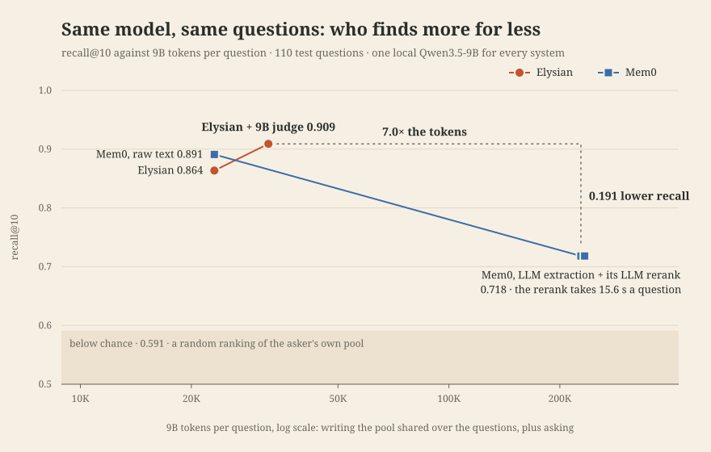

# Elysium and Mem0 on one pool

- commit: `d066d71e397c28810e08551fb62e28ed0106d3c8`; machine: 32 cpus, load [0.88, 0.81, 1.28]
- 110 test questions (code 20, conversation 10, image 20, pdf 20, ui_screenshot 20, video 20), 619 sources, 1963 items of at most 8000 characters given to Mem0
- chance (a random ranking of the asker's pool): recall@10 0.5911
- LLM for every system: the same local Qwen3.5-9B on vLLM, thinking off; embedder for Mem0: local MiniLM
- cost: 9B tokens per question = (descriptions + the arm's own writing) / questions + tokens spent asking
- descriptions, shared by every arm: 2051 pictures described by Elysium's ingest in 637 s, 1,937,327 + 602,240 tokens; Mem0 reads the same words

- Mem0: `add()` into a Qdrant server with its BM25 hybrid and spaCy entity linking, raw (`infer=False`) and inferred; its rerank is its `llm_reranker` on the 9B

| arm | recall@10 | hit@10 Wilson lower | MRR | 9B tokens / question | own write tokens (prompt + generated) | writes failed | own write s | p50 s | p95 s |
| --- | --- | --- | --- | --- | --- | --- | --- | --- | --- |
| elysium | 0.864 | 0.787 | 0.656 | 23,087 | 0 + 0 | 0 | 0 | 0.07 | 0.25 |
| elysium + 9B judge | 0.909 | 0.841 | 0.738 | 32,365 | 0 + 0 | 0 | 0 | 0.79 | 1.21 |
| mem0 raw | 0.891 | 0.819 | 0.717 | 23,087 | 0 + 0 | 0 | 96 | 0.04 | 0.07 |
| mem0 | 0.718 | 0.628 | 0.594 | 228,116 | 21,359,739 + 1,193,475 | 0 | 19279 | 0.03 | 0.05 |
| mem0 + LLM rerank | 0.718 | 0.628 | 0.624 | 233,436 | 21,359,739 + 1,193,475 | 0 | 19279 | 15.57 | 17.95 |

## recall@10 by modality

| arm | code | conversation | image | pdf | ui_screenshot | video |
| --- | --- | --- | --- | --- | --- | --- |
| elysium | 0.950 | 1.000 | 0.850 | 0.950 | 0.650 | 0.850 |
| elysium + 9B judge | 0.950 | 1.000 | 0.950 | 0.950 | 0.800 | 0.850 |
| mem0 raw | 0.950 | 1.000 | 0.950 | 1.000 | 0.600 | 0.900 |
| mem0 | 0.300 | 0.900 | 0.850 | 1.000 | 0.450 | 0.900 |
| mem0 + LLM rerank | 0.300 | 0.900 | 0.850 | 1.000 | 0.450 | 0.900 |

Latency and write seconds move with machine load; one run.
